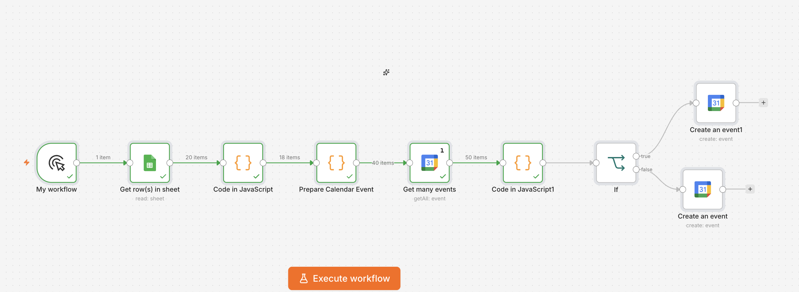
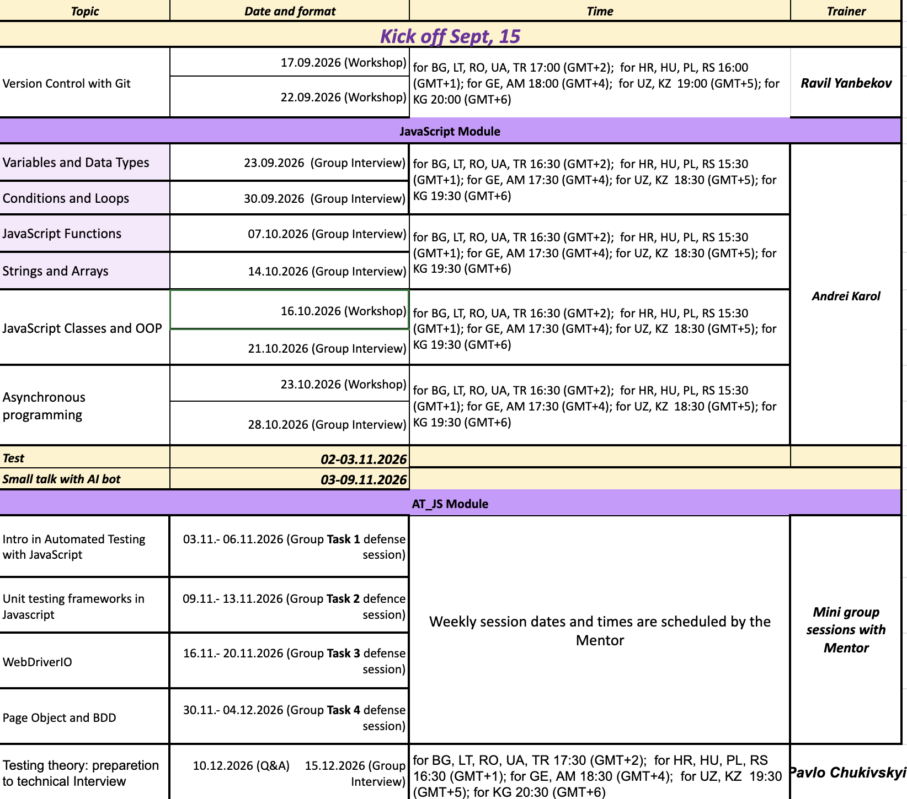

# Excel to Google Calendar Automation

An n8n automation workflow that converts schedule data from an Excel/Google Sheets file into Google Calendar events automatically.

## Project Overview

This project automates the process of transferring schedule information from a spreadsheet to Google Calendar.

Instead of manually creating each calendar event, the workflow reads the schedule, processes the data, and creates corresponding events in Google Calendar.

## Workflow

The automation follows this process:

**Spreadsheet → n8n → Data Processing → Google Calendar**

### Main steps

1. Read schedule data from the spreadsheet.
2. Process and prepare the event information.
3. Create calendar events in Google Calendar.
4. Verify the created events.

## Technologies

* n8n
* Google Sheets
* Google Calendar
* JavaScript
* Workflow automation

## Example Use Case

This workflow was created to automate the creation of calendar events from an EPAM training schedule.

Example data can include:

* Event name
* Date
* Start time
* End time

The automation converts this information into Google Calendar events.

## Project Structure

```text
excel-to-google-calendar-n8n/
│
├── README.md
│
├── workflow/
│   └── epam-schedule-to-calendar.json
│
└── screenshots/
    ├── workflow.png
    ├── google-sheets.png
    └── google-calendar.png
```

## Screenshots

### n8n Workflow



### Source Data



### Google Calendar Result


## What I Practiced

* Building an automation workflow in n8n
* Working with Google Sheets
* Working with Google Calendar
* Processing structured data
* Creating calendar events automatically
* Testing and debugging an automation workflow
* Organizing an automation project for GitHub

## Future Improvements

* Add duplicate-event protection
* Add validation for missing or incorrect data
* Add error notifications
* Support different calendar types
* Add more flexible date and time processing
